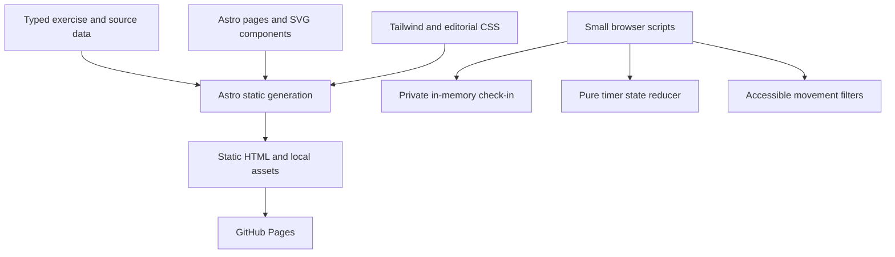

# deadbutt.fyi

A playful, evidence-aware field guide to gluteal amnesia, sitting, and reconnecting through movement. Built with **Astro 7, Tailwind CSS 4, and GitHub Pages**. No client framework, accounts, analytics, or external font requests.

## Develop

Requires Node.js 22.12+ (CI uses Node 24).

```sh
npm ci
npm run dev
```

Use the local URL printed by Astro; it selects an available port. Astro 7 may run the development server in the background. Use `npx astro dev status`, `npx astro dev logs`, and `npx astro dev stop` to manage it.

```sh
npm run check
npm test
npm run build
npm run preview
```

## Experience

- An illustrated home page with a playful, interactive peach mascot.
- A detailed guide to sitting, anatomy, symptoms, pelvic tilt, hamstrings, and feet.
- A non-diagnostic check-in that routes concerning symptoms to care immediately.
- Six movement guides with starting amounts, adaptations, progression, and print styles.
- A three-minute movement timer with pause, skip, reset, and seated alternatives.
- A source library that explains evidence limits and editorial choices.



## Deployment and domain

Pushing to `main` runs type checks, behavioral tests, the production build, and a GitHub Pages deployment. Pull requests run checks and build without deploying. In repository settings, Pages must use **GitHub Actions** as its source.

The canonical site is `https://deadbutt.fyi`, also declared in `public/CNAME`. The apex DNS must point to GitHub Pages:

| Type | Host | Value |
| --- | --- | --- |
| A | @ | 185.199.108.153 |
| A | @ | 185.199.109.153 |
| A | @ | 185.199.110.153 |
| A | @ | 185.199.111.153 |
| CNAME | www (optional) | crs48.github.io |

Set the custom domain to `deadbutt.fyi` in Pages settings and enable HTTPS after GitHub provisions the certificate. Do not add wildcard DNS records. The root A records were already configured when this project was built.

For a preview under a project subpath, build with `SITE_URL=https://crs48.github.io BASE_PATH=/deadbutt/ npm run build`. All internal links and assets use the configured base. Remove the CNAME when actually deploying under a different domain.

## Content and safety

Sources and their limitations live in `src/data/sources.ts`; movement descriptions live in `src/data/moves.ts`. No quiz score should diagnose a condition. Red-flag answers must never recommend exercise. Do not equate gluteal weakness with tendon disease or nerve symptoms, promise to correct pelvic tilt, or claim shoes cure gluteal amnesia.

The exercises and their starting amounts are editorial examples, not a validated rehabilitation protocol. Content has not been individually reviewed by a medical professional. Keep those limitations visible when editing.

Check-in answers exist only in the current document's memory. There is no storage or network submission. GitHub's normal hosting logs are outside the application. The movement timer measures elapsed time and pauses when the document becomes hidden; it does not notify users or run in the background.

## Visuals and maintenance

Original inline SVG illustrations; Bricolage Grotesque and DM Sans are self-hosted through Fontsource. `node scripts/social-image.mjs` regenerates the local Open Graph image. All primary reading content works without JavaScript; the form submit is disabled until its client handler is ready. The movement break includes static instructions.

See [the build checklist](docs/BUILD_PLAN.md) for implementation status and [verification notes](docs/VERIFICATION.md) for what was tested.
