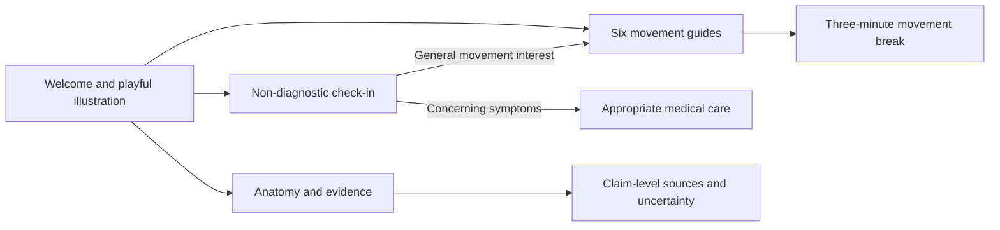

# deadbutt.fyi build plan

- [x] Review crs.land and Floor Life, Nervous System Healing, Food Forests, and AI Explained.
- [x] Research terminology, activity guidance, pelvic tilt, footwear, and escalation signs.
- [x] Set up Astro, Tailwind, self-hosted fonts, accessible layouts, and original SVG artwork.
- [ ] Finish the illustrated guide, movement library, check-in, and three-minute break.
- [ ] Verify safety routing, timer behavior, routes, responsive layouts, and production build.
- [ ] Publish through GitHub Pages and document custom-domain setup.

The experience moves from curiosity to understanding to an achievable next step. No diagnostic scoring, promises of postural correction, product sales, accounts, or collection of symptom data.

